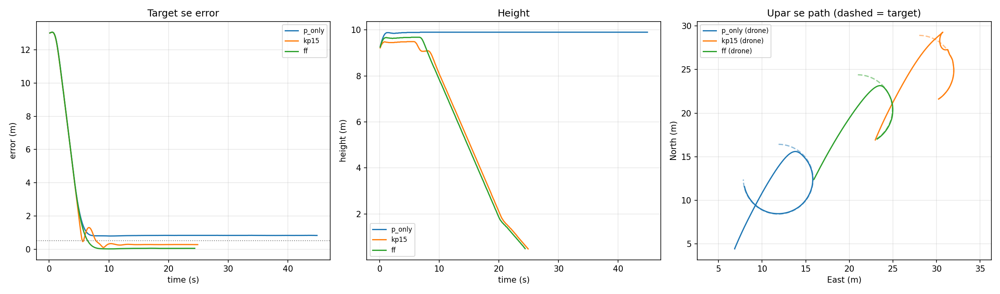

# Precision Landing on a Moving Target (ArduPilot SITL)

A closed-loop controller that flies an ArduCopter drone over a target and lands on it, written in Python with `pymavlink` and tested in ArduPilot's Software-In-The-Loop (SITL) simulator.

This is Stage 1 of a camera-based precision landing project. Here the target position is simulated; in Stage 2 it comes from an ArUco marker detected by a camera.

## What it does

Every ~0.1 s the script:

1. Reads the drone's position (`LOCAL_POSITION_NED`).
2. Computes the error to the target.
3. Sends a velocity command (`SET_POSITION_TARGET_LOCAL_NED`) to close that error.
4. Descends only while the drone is centred over the target.

A mission planned in a ground station cannot do this, because the target can move and the drone has to react to it in real time.

## Controller

```
v = Kp * error                 (P control)
v = v_target + Kp * error      (P control + feedforward)
```

- **Hysteresis:** start descending below 0.5 m error, stop descending above 1.0 m. This stops the drone from switching between descending and holding.
- **Tracking to the ground:** the target is tracked down to 0.5 m height, and the descent slows below 2 m. Only then does the script switch to `LAND` mode.

## Results

The target moves on a 4 m radius circle at 0.42 m/s.

| Run | Kp | Feedforward | Steady-state error (measured) | Predicted |
|---|---|---|---|---|
| `p_only` | 0.5 | No | 0.83 m (never lands) | 0.42 / 0.5 = 0.84 m |
| `kp15` | 1.5 | No | 0.28 m, overshoot to 1.3 m | 0.42 / 1.5 = 0.28 m |
| `ff` | 0.5 | Yes | ~0.04 m | 0.42 m/s x 0.1 s loop = 0.042 m |



**What this shows:**

- A P controller following a moving target always lags by `v_target / Kp`. The measured values match this prediction.
- Raising Kp reduces the lag but causes overshoot. With real sensor noise and delay this would get worse.
- Feedforward removes almost all of the lag without raising Kp. The ~4 cm that is left comes from the one-loop delay between reading the position and the drone responding.

## Safety

Both of these were tested in SITL:

- **Ctrl+C** while flying puts the drone in `LAND` mode instead of leaving it hovering.
- **Timeouts:** if the drone is not centred within 45 s, or the flight lasts more than 180 s, it switches to `RTL`.

## How to run

Requirements: ArduPilot SITL, Python 3, `pymavlink`, `matplotlib`.

```bash
# Terminal 1: start the simulator
sim_vehicle.py -v ArduCopter

# Terminal 2: run a landing, wait until the ground station shows "Ready"
python3 fake_target_land.py --move --ff --log ff.csv

# Plot one or more runs
python3 plot_logs.py p_only.csv kp15.csv ff.csv
```

Options:

| Flag | Meaning |
|---|---|
| `--move` | Target moves on a circle |
| `--ff` | Turn on feedforward |
| `--log NAME.csv` | Save the run to a CSV file |
| `--alt`, `--north`, `--east` | Takeoff height and target offset (m) |

## Files

| File | Purpose |
|---|---|
| `fake_target_land.py` | Controller, safety logic, logging |
| `plot_logs.py` | Error, height and top-down path plots |
| `aruco_webcam.py` | Stage 2: ArUco marker detection with a webcam (in progress) |
| `*.csv` | Logs of the runs in the table above |

## Limitations

- In SITL the drone knows its own position almost perfectly. On real hardware GPS error is around 1-3 m, so landing on GPS alone would miss by that much. This is why the next stage uses a camera to measure where the target is relative to the drone.

## Next steps

1. Detect an ArUco marker with a webcam and estimate its position.
2. Feed the camera measurement into this controller instead of the simulated target.
3. Compare with ArduPilot's built-in precision landing (`LANDING_TARGET` message).
4. Test in Gazebo with a simulated downward camera, then on real hardware.

## Author

Krishna Aggarwal, B.Tech Mechanical Engineering, Dronacharya Group of Institutions, Greater Noida.
