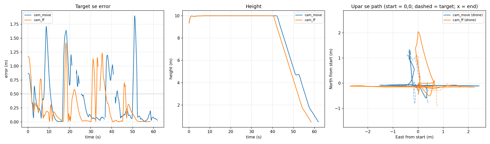
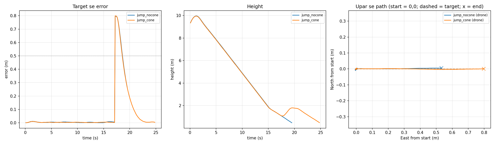
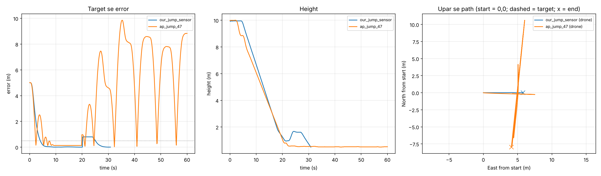
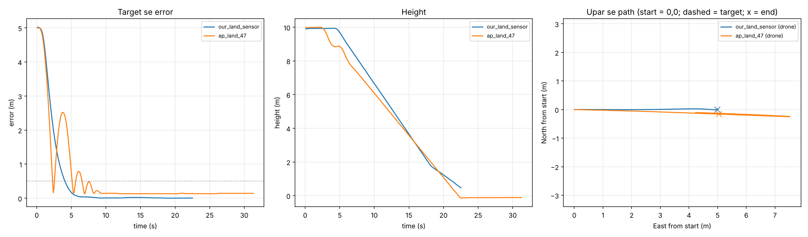

# Precision Landing on a Moving Target (ArduPilot SITL)

A closed-loop controller that flies an ArduCopter drone over a target and lands on it, written in Python with `pymavlink` and tested in ArduPilot's Software-In-The-Loop (SITL) simulator.

- **Stage 1:** the target position is simulated (fixed or moving on a circle).
- **Stage 2:** an ArUco marker is detected with a webcam and its position estimated.
- **Stage 3:** the webcam detection drives the simulated drone in real time.
- **Stage 4:** comparison with ArduPilot's built-in precision landing, on three firmware versions.

## What it does

Every ~0.1 s the script:

1. Reads the drone's position (`LOCAL_POSITION_NED`).
2. Computes the error to the target.
3. Sends a velocity command (`SET_POSITION_TARGET_LOCAL_NED`) to close that error.
4. Descends only while the drone is centred over the target.

A mission planned in a ground station cannot do this, because the target can move and the drone has to react to it in real time.

## Controller

```
v = Kp * error                 (P control)
v = v_target + Kp * error      (P control + feedforward)
```

- **Hysteresis:** start descending below 0.5 m error, stop descending above 1.0 m. This stops the drone from switching between descending and holding.
- **Tracking to the ground:** the target is tracked down to 0.5 m height, and the descent slows below 2 m. Only then does the script switch to `LAND` mode.

## Results

The target moves on a 4 m radius circle at 0.42 m/s.

| Run | Kp | Feedforward | Steady-state error (measured) | Predicted |
|---|---|---|---|---|
| `p_only` | 0.5 | No | 0.83 m (never lands) | 0.42 / 0.5 = 0.84 m |
| `kp15` | 1.5 | No | 0.28 m, overshoot to 1.3 m | 0.42 / 1.5 = 0.28 m |
| `ff` | 0.5 | Yes | ~0.04 m | 0.42 m/s x 0.1 s loop = 0.042 m |


**What this shows:**

- A P controller following a moving target always lags by `v_target / Kp`. The measured values match this prediction.
- Raising Kp reduces the lag but causes overshoot. With real sensor noise and delay this would get worse.
- Feedforward removes almost all of the lag without raising Kp. The ~4 cm that is left comes from the one-loop delay between reading the position and the drone responding.

## Stage 3: a real camera drives the simulated drone

`aruco_sitl_land.py` detects an ArUco marker held in front of a laptop webcam. The marker's offset from the camera centre (scaled by a gain) becomes the target for the same controller as Stage 1. Moving the marker 15 cm moves the target 1.5 m (gain 10).

**Camera calibration (Stage 2):** the marker distance was checked against a tape measure at 35.5, 51 and 90 cm. The estimate was consistently 3.4% short at all three distances, which points to the assumed field of view rather than lens distortion. Correcting the horizontal FOV from 70 to 68.2 degrees fixed it.

**What the tests showed:**

| Test | Result |
|---|---|
| Marker held still | Lands within ~0.03 m of the target |
| Marker hidden for up to 6 s | Drone hovers and stops descending, then resumes when the marker returns |
| Marker moved in 15 cm steps during descent | Error jumps above 1.0 m, descent stops (hysteresis), drone re-centres, descent resumes |
| Detection noise | With the marker at rest, the distance estimate varied by about ±1 mm. At gain 20 that is only ~2 cm of target movement, so most of the target jitter in these tests came from the hand, not the detector. Gain multiplies both equally |
| Fast marker movement | Brief detection losses, most likely from motion blur |
| Feedforward with step moves | Feedforward from the camera's velocity estimate overshot on sudden steps (drone went ~2 m when the target moved ~1 m). Feedforward helps for smooth motion but hurts for jumpy, noisy input |



**Important limitation:** the webcam does not move with the drone, so this is not yet a closed loop through the camera. The camera only reports where the target is; the drone moving does not change what the camera sees. A real closed loop needs a camera mounted on the drone (Gazebo or hardware).

## Landing cone

Fixed tolerances (start descending below 0.5 m error, stop above 1.0 m) are fine at 10 m but too loose near the ground: the drone can touch down far from the target. With `--cone` the allowed error shrinks with height (0.5 m at 10 m, down to 0.15 m below 3 m; stop = 2x start). If the drone goes off-target below 1.5 m, it climbs back to 1.5 m, re-centres and descends again (a retry, like ArduPilot's built-in precision landing).

Test: the target jumps 0.8 m sideways when the drone reaches 1.2 m (`--jump 0.8`).

| Run | Behaviour after the jump | Touchdown error | Time to land |
|---|---|---|---|
| Fixed tolerance | Kept descending (0.8 m < 1.0 m stop limit), switched to LAND 0.27 m off | **0.17 m** | 19.5 s |
| Cone | Stopped, climbed to ~1.8 m, re-centred, descended | **0.01 m** | 24.8 s |

The cone trades about 5 s of landing time for a 17x smaller touchdown error.

Note: earlier runs reported the error at 0.5 m height, just before LAND mode. The script now also reports the **touchdown error** (where the drone actually lands), because the drone keeps drifting during LAND.



## Stage 4: comparison with ArduPilot's built-in precision landing

`builtin_precland.py` runs ArduPilot's own precision landing (`PLND_TYPE 4`, the SITL landing-target sensor, with a simulated rangefinder) on the same test as my controller: pad 5 m East, descent from 10 m, and optionally the pad jumping 0.8 m sideways when the drone reaches 1.2 m. ArduPilot parameters were left at their defaults.

To make the comparison fairer, my controller was also given a simulated camera (`--sensor`): the target is only visible inside a 30 degree cone below the drone, with 0.5 degree angle noise, a 0.15 s delay and a low-pass filter. If the target leaves the view, the drone hovers, then climbs until it sees the target again.

| Run | Normal landing: touchdown error | Pad jump at 1.2 m |
|---|---|---|
| My controller (cone + simulated camera) | **0.00 m** | **Lands, 0.01 m.** Target left the camera view at 1.1 m; the drone climbed to 1.4 m, saw it again, re-centred and landed |
| ArduPilot 4.7.2 (latest stable) | 0.13 m | **Did not land in 60 s.** Swung up to 9.8 m away at 0.5 m height |
| ArduPilot 4.5.7 | 0.18 m | Did not land in 60 s (up to 7.2 m away) |
| ArduPilot 4.8.0-dev | 0.10 m | Did not land in 60 s, in 3 of 3 runs (up to 9.8 m away) |
| ArduPilot 4.7.2, `PLND_OPTIONS=1` (moving target) | n/a | Did not land in 60 s. Also oscillated before the jump (mean error 0.76 m vs 0.14 m with defaults) |

The swinging was checked visually in QGroundControl, not only from the logged numbers.



**Other observations:**

- ArduPilot held a constant ~0.13 m offset from the pad for the whole descent. I do not know the cause yet.
- In all three firmware versions, about 2 s after touchdown ArduPilot reported "Target Lost", then started a retry and lifted off again. The script now detects touchdown itself and disarms (SITL only).
- `SIM_PLD_LAT/LON` are 32-bit floats: at longitude 77 that is a ~0.75 m step. The script reads the stored values back and measures against those.

**Why this is not a fair win for my controller (yet):**

- My camera model ignores the drone's tilt. A real camera tilts with the drone when it accelerates, which shifts where the target appears. ArduPilot's estimator has to deal with that; mine does not.
- I chose the camera noise, delay and field of view myself. They are not measured from a real sensor, and ArduPilot's simulated sensor has its own, different model.
- A pad that teleports 0.8 m in one step is an extreme test. ArduPilot's documentation says its estimator assumes a stationary target.
- My controller uses the drone's own position estimate, which in SITL is close to perfect.

So the honest conclusion is: with default settings, ArduPilot's precision landing in SITL did not recover from a sudden 0.8 m target jump near the ground in any of the three versions tested, while a simple cone + "climb to regain view" strategy did. Whether that holds with tilt, real sensor noise and real hardware is the next thing to test.



## Safety

Both of these were tested in SITL:

- **Ctrl+C** while flying puts the drone in `LAND` mode instead of leaving it hovering.
- **Timeouts:** if the drone is not centred within 45 s, or the flight lasts more than 180 s, it switches to `RTL`.
- **Marker lost (Stage 3):** unseen for 0.5 s -> hover and stop descending; unseen for 10 s -> `RTL`.

## How to run

Requirements: ArduPilot SITL, Python 3, `pymavlink`, `matplotlib`.

```bash
# Terminal 1: start the simulator
sim_vehicle.py -v ArduCopter

# Terminal 2: run a landing, wait until the ground station shows "Ready"
python3 fake_target_land.py --move --ff --log ff.csv

# Plot one or more runs
python3 plot_logs.py p_only.csv kp15.csv ff.csv

# Stage 2: marker detection only
python3 aruco_webcam.py --make-marker        # print it, measure the black square
python3 aruco_webcam.py --size 0.146 --hfov 68.2

# Stage 3: webcam drives the SITL drone (follow for 40 s, then land)
python3 aruco_sitl_land.py --gain 10 --hover 40 --log cam_move.csv

# Stage 4: ArduPilot's built-in precision landing (setup once, then restart SITL without -w)
python3 builtin_precland.py --setup
python3 builtin_precland.py --jump 0.8 --log ap_jump.csv
python3 fake_target_land.py --north 0 --east 5 --cone --sensor --jump 0.8 --log our_jump_sensor.csv
```

Options:

| Flag | Meaning |
|---|---|
| `--move` | Target moves on a circle |
| `--ff` | Turn on feedforward |
| `--cone` | Landing cone: allowed error shrinks with height, retry if off-target low down |
| `--jump D` | Target jumps D m East when the drone first descends below 1.2 m |
| `--sensor` | See the target through a simulated camera (30 deg view, noise, delay); hover and climb if it is lost |
| `--log NAME.csv` | Save the run to a CSV file |
| `--alt`, `--north`, `--east` | Takeoff height and target offset (m) |

## Files

| File | Purpose |
|---|---|
| `fake_target_land.py` | Controller, safety logic, logging |
| `plot_logs.py` | Error, height and top-down path plots |
| `aruco_webcam.py` | Stage 2: ArUco marker detection and distance/angle estimate |
| `aruco_sitl_land.py` | Stage 3: webcam marker detection drives the SITL drone |
| `builtin_precland.py` | Stage 4: ArduPilot's built-in precision landing on the same test (`--setup` once) |
| `*.csv` | Logs of the runs above (`cam_*.csv` Stage 3, `our_*.csv` / `ap_*.csv` Stage 4) |
| `compare.png`, `stage3_*.png`, `cone_compare.png`, `stage4_*.png` | Plots of the runs |

## Limitations

- In SITL the drone knows its own position almost perfectly. On real hardware GPS error is around 1-3 m, so landing on GPS alone would miss by that much. This is why the next stage uses a camera to measure where the target is relative to the drone.

## Next steps

1. Add the drone's tilt to the camera model and repeat the Stage 4 comparison.
2. Report the ArduPilot behaviour (no recovery after a target jump, retry after touchdown) on the ArduPilot forum with the logs.
3. Test in Gazebo with a simulated downward camera, closing the loop through the camera.
4. Calibrate a real drone camera (chessboard) and test on hardware.

## Author

Krishna Aggarwal, B.Tech Mechanical Engineering, Dronacharya Group of Institutions, Greater Noida.
